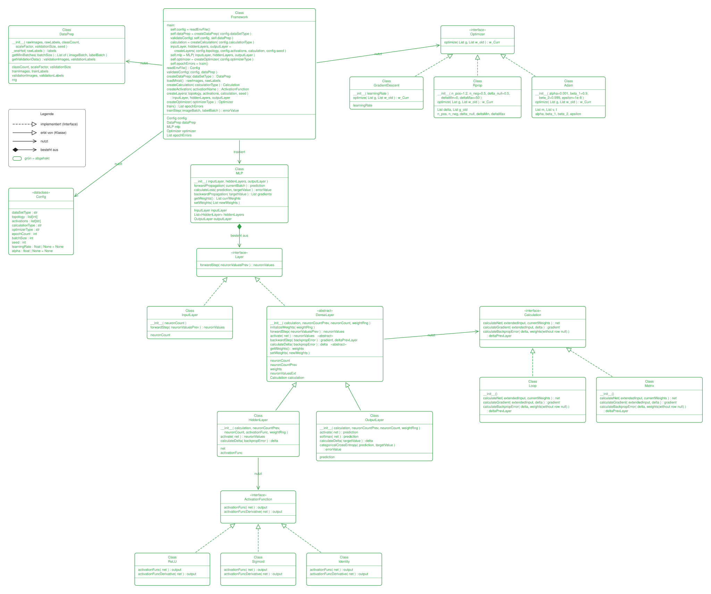
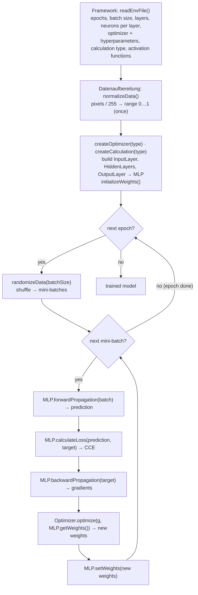

# MLP architecture (milestone 2)

How our multilayer perceptron is put together and how one training run flows through it.
Based on the class diagram we're drawing in Excalidraw.

| File | What it is |
|------|------------|
| [`mlp-architecture.excalidraw`](mlp-architecture.excalidraw) | **Source** — open on [excalidraw.com](https://excalidraw.com) (☰ → Open) and edit there |
| [`mlp-architecture.svg`](mlp-architecture.svg) | Read-only export so GitHub can show it (re-export after every change, see [below](#updating-the-diagram)) |

**Legend** (as in the diagram): dashed line + hollow triangle = *implements (interface)*, solid line +
hollow triangle = *inherits from (class)*, plain arrow = *uses*, diamond = *consists of*.
**Green = done** (designed): everything except `Framework` and `Datenaufbereitung`, which are still open.

---

## 1. Components at a glance

| # | Component | Role | Key methods |
|---|-----------|------|-------------|
| 1 | **Framework** (`main`) | Reads the config, builds everything, runs the epoch/batch loop | `readEnvFile()`, `createOptimizer()`, `createCalculation()`, `trainModel()`, `initializeGradients()` |
| 2 | **Datenaufbereitung** (data prep) | Normalizes raw data once, shuffles + splits into mini-batches every epoch | `normalizeData()`, `randomizeData(batchSize)` |
| 3 | **MLP** | The network: holds the layers, runs forward/backward passes over all of them | `forwardPropagation()`, `calculateLoss()`, `backwardPropagation()`, `getWeights()`, `setWeights()` |
| 4 | **Layer** «interface» | What every layer can do | `forwardStep(neuronValuesPrev)` |
| 5 | **InputLayer** | Passes the input through, computes nothing | `forwardStep()` |
| 6 | **DenseLayer** «abstract» | Shared logic of all layers with weights | `initializeWeights()`, `forwardStep()`, `backwardStep()`, abstract `activate()` / `calculateDelta()` |
| 7 | **HiddenLayer** | Dense layer with a per-layer activation function | `activate()`, `calculateDelta(backpropError)` |
| 8 | **OutputLayer** | Dense layer with softmax + categorical cross-entropy (CCE) | `softmax()`, `categoricalCrossEntropy()`, `calculateDelta(targetValue)` |
| 9 | **ActivationFunction** «interface» | `ReLU`, `Sigmoid`, `Identität` (identity) | `activationFunc(net)`, `activationFuncDerivative(net)` |
| 10 | **Calculation** «interface» | *How* the math runs: `Loop` (explicit loops) or `Matrix` (NumPy matrix ops) | `calculateNet()`, `calculateGradient()`, `calculateBackpropError()` |
| 11 | **Optimizer** «interface» | Updates the weights from the gradients: `Gradientenabstieg` (gradient descent), `Rprop`, `Adam` | `optimize(g, w_old) → w_curr` |

Two places where we swap in implementations (strategy pattern):

- **Calculation** (`Loop` vs `Matrix`): same results, different implementation. Chosen once via `calculationType`
  and passed to every dense layer.
- **Optimizer** (`Gradientenabstieg` / `Rprop` / `Adam`): chosen via `optimizerType`. Each one keeps its
  own state between steps (Adam: `m`, `v`, `t`; Rprop: step sizes `delta`, previous gradient `g_old`).

## 2. Data layout conventions

- A weight matrix between layer *A* (M neurons) and layer *A+1* (N neurons) has shape **(M+1) × N**.
  **Row 0 holds the thresholds θ** (bias) of the N neurons; rows 1…M are the real weights.
- To make that work, every layer input is **extended with a constant −1 at index 0**
  (`neuronValuesExt`), so `net_j = Σ_i w_ij · o_i` with `w_0j = θ_j`, `o_0 = −1`.
- One weight matrix per transition between layers. `m`, `v` (Adam) and `g` have the same shapes as the weights.
- Initialization: weights ~ N(0, √(2/M)) (He init) for rows 1…M, thresholds (row 0) = 0, `m` and `v` = 0.

## 3. Workflow of a training run

### 3.1 Setup (once)

1. **`readEnvFile()`** loads the run config: `epochCount`, `batchSize`, `layerCount`, `neuronPerLayerCount`,
   `optimizerType` (+ `alpha`, `beta_1`, `beta_2`, `epsilon`), `calculationType` and the array of activation functions.
2. **`DataPrep()`** is constructed → `__init__` calls `normalizeData()` once (divide by 255).
3. **`createOptimizer(optimizerType)`** and **`createCalculation(calculationType)`** pick the implementations.
4. The layers are created and handed to **`MLP(inputLayer, hiddenLayers, outputLayer)`**. Every dense layer gets
   `neuronCountPrev`, `neuronCount` and the shared `calculation`; hidden layers also get their activation function.
   `initializeWeights()` sets up each weight matrix as described in [section 2](#2-data-layout-conventions).

### 3.2 Per epoch

- **`randomizeData(batchSize)`** shuffles the training data and splits it into mini-batches
  (batch size = full dataset for full-batch training, e.g. with Rprop).

### 3.3 Per mini-batch: forward pass

`MLP.forwardPropagation(currentBatch)` calls `forwardStep()` layer by layer:

1. **InputLayer** passes the batch through unchanged.
2. Each **HiddenLayer** (`DenseLayer.forwardStep`):
   - prepends −1 to its input → `neuronValuesExt` (stored for backprop),
   - `calculation.calculateNet(extendedInput, weights)` → `net` (stored),
   - `activate(net)` → applies its `ActivationFunction` (ReLU / Sigmoid / identity) → output to the next layer.
3. **OutputLayer**: same `net` computation, then **`softmax(net)`** over the whole layer → `prediction` (stored).

### 3.4 Loss

`MLP.calculateLoss(prediction, targetValue)` → `OutputLayer.categoricalCrossEntropy()` → error value
(for monitoring; backprop does not need it directly).

### 3.5 Backward pass

`MLP.backwardPropagation(targetValue)` walks the dense layers **from back to front**:

1. **OutputLayer** `calculateDelta(targetValue)`: the combined derivative of softmax + CCE is simply
   **δ = o − t** (prediction minus one-hot target). This is where backprop starts.
2. Every dense layer then runs **`backwardStep()`**:
   - gradient: `calculation.calculateGradient(extendedInput, δ)` = extended input × δ (includes the θ row),
   - error for the layer before: `calculation.calculateBackpropError(δ, weights without row 0)`
     → `deltaPrevLayer` (θ row is dropped because the constant −1 has no predecessor).
3. **HiddenLayer** `calculateDelta(backpropError)`: δ = backpropError × `activationFuncDerivative(net)`.
4. It stops at the first hidden layer; the InputLayer computes nothing.
5. Result: one gradient matrix per weight matrix → `List gradients`.

### 3.6 Weight update

1. `Optimizer.optimize(gradients, MLP.getWeights())` computes the new weights:
   - **Gradientenabstieg** (gradient descent): `w ← w − learningRate · g`
   - **Rprop**: per-weight step size, grows by `n_pos = 1.2` if the gradient sign stays the same, shrinks by
     `n_neg = 0.5` if it flips, clamped to `[deltaMin, deltaMax]`, start `delta_null`; only the sign of `g` is used.
   - **Adam**: increments step counter `t`, updates moments `m`, `v`, bias-corrects them, `w ← w − α · m̂ / (√v̂ + ε)`.
2. `MLP.setWeights(newWeights)` writes them back into the layers.
3. Next mini-batch.

## 4. Open points (from the current diagram)

Things to settle before/while implementing:

- [ ] **Framework + Datenaufbereitung are not finished yet** (black in the diagram).
- [ ] In the Framework pseudo-code, the layers are created **inside** the mini-batch loop, which would reset the
      weights every batch. They should be built once, before the epoch loop.
- [ ] `trainModel()` is called in the Framework but not defined anywhere yet; the per-batch steps of 3.3–3.6
      are probably what it should contain.
- [ ] Targets: `randomizeData()` has to shuffle images **and labels** together, and labels need one-hot encoding
      for `δ = o − t`. Neither is in the diagram yet.
- [ ] `OutputLayer.calculateDelta(targetValue)` and the abstract `calculateDelta(backpropError)` take different
      inputs. Decide whether the signatures stay different or both take one generic argument.
- [ ] `Layer` only declares `forwardStep`; `backwardStep` is defined on `DenseLayer` only (fine, since InputLayer
      has no backward step, but MLP must then only call it on dense layers).
- [ ] `initializeGradients()` in the Framework: zeroed gradient matrices are only needed for the `Loop` calculation.
- [ ] No evaluation step yet (validation/test accuracy per epoch).

## Updating the diagram

1. Edit `mlp-architecture.excalidraw` on excalidraw.com, then save it back into this folder under the **same name**
   (☰ → Save to… / download, then replace the file).
2. Re-export the SVG: on excalidraw.com, ☰ → Export image → SVG, with background on, and save it as
   `mlp-architecture.svg` (overwrite).
3. Update this file if the workflow changed, then commit all three together.
